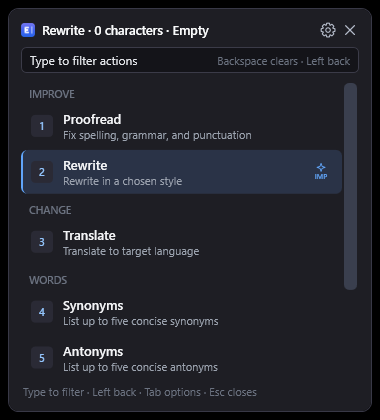
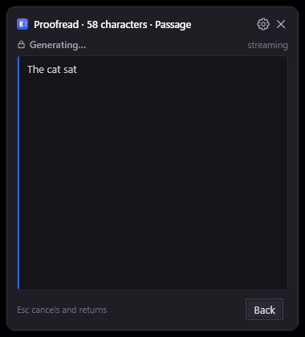
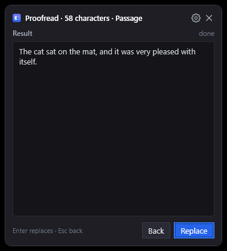
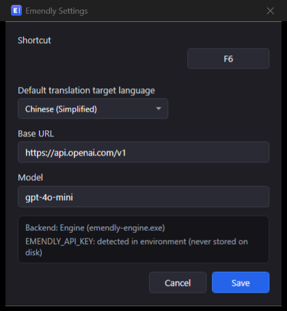
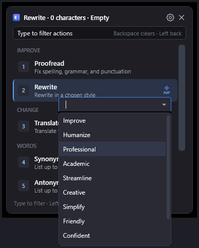

<p align="center">
  
</p>

<h1 align="center">Emendly</h1>

<p align="center">
  A writing assistant that lives in every app — and only wakes when you ask.
</p>

<p align="center">
  
  
  
  
</p>

<p align="center">
  <a href="site/index.html">Website</a> ·
  <a href="https://github.com/pwwang/emendly/releases/latest">Download</a> ·
  <a href="site/privacy.html">Privacy</a> ·
  <a href="#support">Support</a>
</p>

---

Select a sentence in any app, press **Ctrl+Alt+E**, and Emendly offers the actions that fit what it sees. Nothing is read until you press the key, and nothing is sent anywhere except the model provider you configured.

## Why another writing assistant

- **System-wide, not browser-only.** Emendly reads the focused field through UI Automation, Scintilla messages or the clipboard, with per-app rules for the apps that hide their text from the accessibility tree.
- **On demand by design.** No background scanning, no keystroke logging, no suggestions popping up while you type.
- **The menu fits the selection.** One word gets proofreading and synonyms; a passage gets rewrite and translation; an empty field gets compose. Seven actions in total.
- **Eleven rewrite styles.** Improve, Humanize, Professional, Academic, Streamline, Creative, Simplify, Friendly, Confident, Diplomatic and Prompt Optimize, pickable on the Rewrite row and remembered between runs.
- **Bring your own model.** Any OpenAI-compatible endpoint, including a local Ollama or LM Studio server, with your own key.
- **A hub for the workflow features.** Saved prompts with per-prompt hotkeys, local run history, a terminology glossary, tone presets, per-app capture rules, action chains and multi-paragraph batch runs — all in the same MIT app, opened from the tray.

## What it looks like

<table>
  <tr>
    <td align="center" width="50%">
      <br />
      <sub><b>The menu fits the selection.</b><br />A passage gets three actions; a single word gets three.</sub>
    </td>
    <td align="center" width="50%">
      <br />
      <sub><b>Results stream in place.</b><br />Read-only while generating, then Replace, Copy or Back.</sub>
    </td>
  </tr>
  <tr>
    <td align="center" width="50%">
      <br />
      <sub><b>Enter replaces the selection</b> through the clipboard, then restores focus to the app you came from.</sub>
    </td>
    <td align="center" width="50%">
      <br />
      <sub><b>Shortcut, language, endpoint, model.</b><br />Set the hotkey by pressing it, not by typing its name.</sub>
    </td>
  </tr>
  <tr>
    <td align="center" colspan="2">
      <br />
      <sub><b>Eleven rewrite styles, one row.</b><br />Humanize and Prompt Optimize are two of them, not separate actions.</sub>
    </td>
  </tr>
</table>

## The seven actions

| Action | What it does | Needs |
|---|---|---|
| **Proofread** | Spelling, grammar and punctuation | a selection |
| **Rewrite** | Eleven writing styles, plus an optional surrounding-context toggle | a selection |
| **Translate** | Into the target language, chosen from a dropdown or typed freehand | a selection |
| **Synonyms** / **Antonyms** | Up to five concise alternatives | a single word |
| **Compose** | Drafts new text from a brief, optionally using the surrounding sentences | an empty caret |
| **Custom Prompt** | Free-text instruction against the current field | anywhere |

Actions are also reachable with the number keys, and `Tab` expands the full grouped list with a filter box.

### Rewrite styles

Pick the style on the Rewrite row with `Space`, exactly like the target language on Translate. The choice
persists, so the next rewrite starts where you left off.

| Style | What it does |
|---|---|
| **Improve** | Clearer and more natural, same meaning (default) |
| **Humanize** | Natural human voice, varied rhythm, no stock phrasing |
| **Professional** | Workplace register, no slang, no exclamation marks |
| **Academic** | Formal scholarly register, precise and hedged |
| **Streamline** | Shorter and tighter, same information |
| **Creative** | More vivid phrasing, still truthful |
| **Simplify** | Plain language, short sentences, common words |
| **Friendly** | Warm and approachable |
| **Confident** | Direct and assertive, no hedging |
| **Diplomatic** | Tactful, softens disagreement |
| **Prompt Optimize** | Clarifies a *prompt* for a model instead of rewriting prose |

Humanize and Prompt Optimize used to be separate top-level actions. They are two of these styles, because
that is what they always were.

## How it decides what to offer

| What Emendly sees | What you get |
|---|---|
| Empty caret | Compose, Custom Prompt |
| One word selected | Proofread, Translate, Synonyms |
| A sentence or passage | Proofread, Rewrite, Translate |
| Read-only text (PDF viewers, terminals) | the same menu, except results can only be copied, not inserted |

Read-only windows are detected rather than guessed: Emendly never pastes into a field that cannot take text.

## How it reads text without a browser

Windows apps hide their text in different ways, so the shell tries strategies in order and remembers what worked per application:

| Strategy | Used for | Example |
|---|---|---|
| **UI Automation** | accessible Win32 and Chromium surfaces | Chrome, Edge, most native apps |
| **Scintilla messages** | `WM_COPY` where the control answers it | Notepad3, Notepad++ |
| **Clipboard probe** | surfaces that publish nothing to UIA | VS Code, Tauri/WebView2 apps, terminals |

`app-rules.json` pins a strategy per executable when the automatic chain guesses wrong, and a `clipboard-nokeys` mode exists so a terminal is never sent a `Ctrl+C` that would read as SIGINT.

## Keyboard

| Key | Action |
|---|---|
| `Ctrl+Alt+E` | open or close the panel (configurable) |
| `↑` `↓` | move between actions |
| `1`–`9` | run an action directly |
| `Tab` / `←` | expand or collapse the full list |
| `Enter` | run, replace, or retry after a failure |
| `Esc` | back one step, then close |

The panel stays open when you click elsewhere: only an explicit close dismisses it.

## Install

Grab the latest build from [GitHub Releases](https://github.com/pwwang/emendly/releases/latest):

- **Windows installer** — `Emendly-vX.Y.Z-win-x64-setup.exe`. Installs per-user to `%LOCALAPPDATA%\Programs\Emendly`, no admin prompt, and adds a Start Menu shortcut and uninstaller.
- **Portable zip** — `Emendly-vX.Y.Z-win-x64.zip`. Unpack anywhere; the engine and its prompt templates sit beside `Emendly.App.exe`.

Or install with winget (manifest lives in `packaging/winget/`):

```sh
winget install pwwang.Emendly
```

After installing, set your endpoint and model in **Settings** and point `EMENDLY_API_KEY` at your provider key (see [Build it](#build-it) for the details).

Installed builds can check GitHub Releases for a newer version on startup, at most once every 24 hours. The check sends only a versioned User-Agent; turn it off in **Settings**.

## Build it

Requires the .NET 9 SDK, the Rust toolchain, and a Windows toolchain for the sidecar.

```sh
# engine
cargo build --release --manifest-path engine/Cargo.toml

# shell
dotnet build shell/windows/Emendly.sln -c Release
```

Run the app, set your endpoint and model in **Settings**, and export a key:

```sh
set EMENDLY_API_KEY=sk-...
```

The key is read from the environment and never written to disk. Settings live in `%APPDATA%\Emendly\settings.json`.

## Support

Emendly is MIT licensed and free. There is no paid tier, no licence key, no trial clock and no activation — every feature in this repository ships in the same open build.

If it saves you time, you can [sponsor the work on GitHub](https://github.com/sponsors/pwwang). Donations pay for signing certificates and release hosting; they buy no features.

## Privacy

- Text is read only after the hotkey, and only from the focused field.
- Logs record action names, app names, latency and byte counts — never your text.
- Requests go to the endpoint you configure. There is no Emendly service in the path.

The full policy, including every local file Emendly writes, is in [`site/privacy.html`](site/privacy.html).

## Status

Windows shell and Rust engine are working end to end: capture, menu, streaming results, replace, settings, tray, and a release pipeline that ships an installer, a portable zip and a winget manifest. A native Swift menu-bar shell for macOS lives in `shell/macos/`; the Rust engine builds on Windows, macOS and Linux, and the protocol is platform-neutral by design.

## Layout

| Path | What lives there |
|---|---|
| `engine/` | Rust sidecar: actions, prompt templates, providers, streaming, token accounting |
| `shell/windows/` | WPF shell: capture strategies, panel, settings, tray |
| `shell/macos/` | Swift menu-bar shell for macOS |
| `packaging/winget/` | winget manifest for `winget install pwwang.Emendly` |
| `site/` | Static landing page and privacy policy, deployed to GitHub Pages |
| `docs/` | protocol, architecture, app coverage, decision records, signing guide |

## Licence

MIT. See [`LICENSE`](LICENSE).
